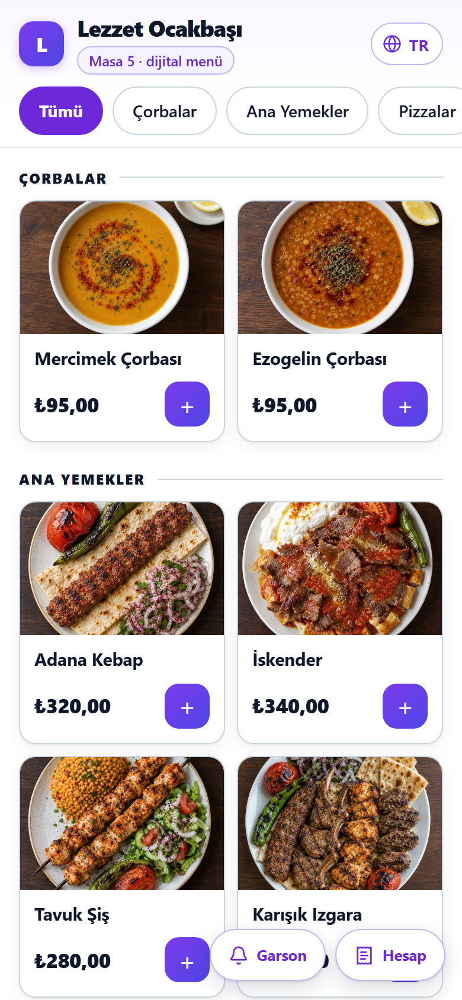
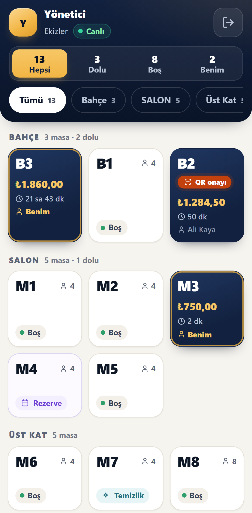
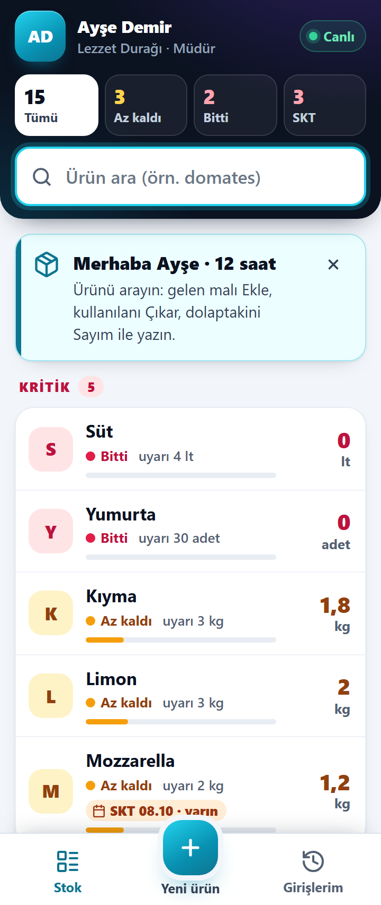

# RestoAI: restoran yönetim ve POS yazılımı

Restoranlar için uçtan uca yönetim yazılımı: sipariş ve adisyon, masa takibi, mutfak, stok, rezervasyon, QR menü, kurye ve raporlama. Mart 2025'ten beri **tek başıma** geliştirip yayında tutuyorum.

> Bu depo ürünün **tanıtımıdır**. Kaynak kod özeldir. Aşağıdaki ekranlar uydurma **demo verisiyle** üretilmiştir; gerçek restoran, müşteri ya da kişi bilgisi içermez.

## Ekranlar

| QR menü (müşteri telefonu) | Garson: masa planı | Stok (telefondan) |
| --- | --- | --- |
|  |  |  |

## Neler var

- **Bulut API**: ASP.NET Core 8 Web API, PostgreSQL, Entity Framework Core
- **Masaüstü POS**: WPF / MVVM, otomatik güncelleme, çok bilgisayarlı kurulum sihirbazı (veritabanı sunucusunu otomatik kurar, terminalleri 6 haneli kodla bağlar)
- **Web ve mobil ekranlar**: garson, QR menü (çok dilli), rezervasyon, telefondan stok, konum doğrulamalı kurye PWA'sı
- **Gerçek zamanlı**: SignalR ile masa ve sipariş durumu anlık güncellenir
- **Entegrasyonlar**: e-SMM (elektronik serbest meslek makbuzu), Google Reserve partner süreci, yapay zekâ destekli sesli sipariş ve çağrı karşılama (konuşmadan metne, metinden konuşmaya, WebRTC)

## Mimari özeti

```
Masaüstü POS (WPF)  ─┐
Garson / QR / Stok   ├──►  ASP.NET Core 8 API  ──►  PostgreSQL
Kurye PWA            ─┘            │
                                   └── SignalR (anlık güncelleme)
Sunucu: Ubuntu · Docker · Caddy (HTTPS) · systemd
```

## Teknolojiler

C# · ASP.NET Core 8 · WPF / MVVM · Entity Framework Core · PostgreSQL · SignalR · JavaScript / Node.js · HTML / CSS · Docker · Caddy · Linux (Ubuntu) · Playwright (uçtan uca testler) · Git

## Süreç

400'ü aşkın commit, düzenli sürüm yayını, otomatik güncelleme, uçtan uca test düzenekleri (gerçek API + SignalR + Playwright) ve yazıcısız fiş önizleme araçları.

## İletişim

Mustafa Gedik · [E-posta](mailto:gs.mustafagedik@gmail.com) · [LinkedIn](https://www.linkedin.com/in/mustafa-gedik-null-556a461b2) · [GitHub](https://github.com/cpu-mustafa)
